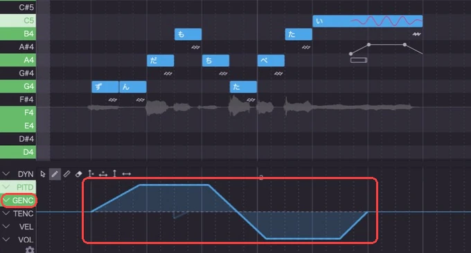
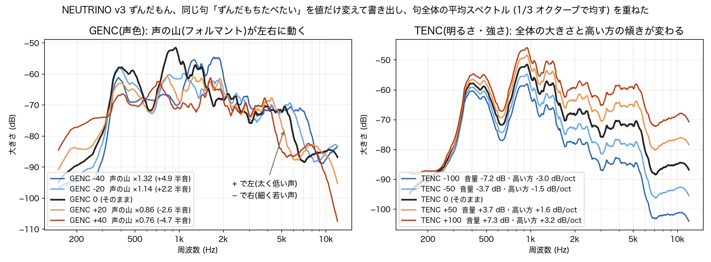
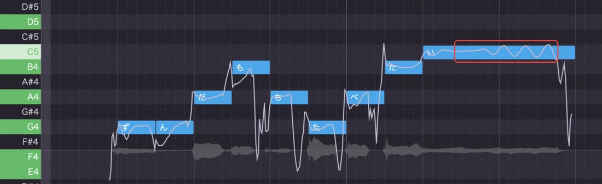
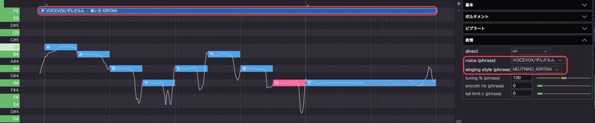
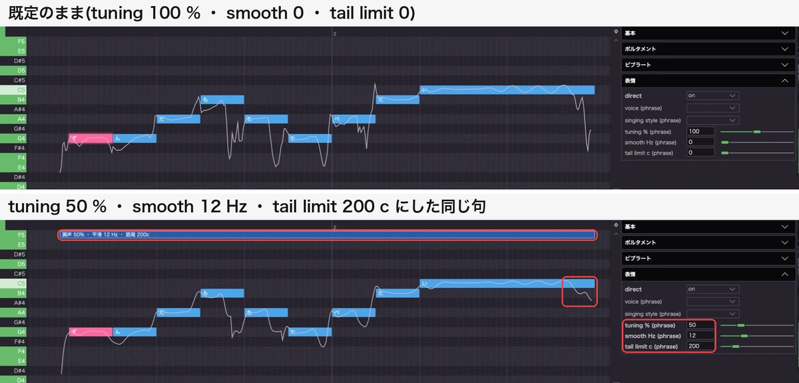
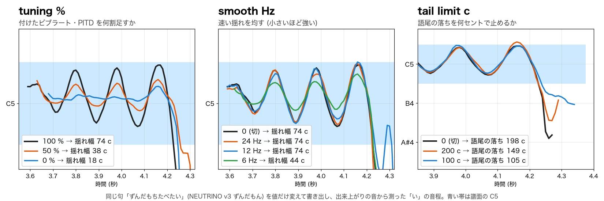

# OpenUtau NEUTRINO対応版(非公式)

本家 [OpenUtau](https://github.com/openutau/OpenUtau) に、rokujyushi さんの NEUTRINO 対応と、この版で足した機能を重ねた非公式ビルドです。

**画面**: ずんだもん(NEUTRINO)の歌を編集している所。


<br>

## ダウンロード

| | 中身 | Mac | Windows(動作未確認) |
|---|---|---|---|
| **固定版** | OpenUtau 0.1.570.3。NEUTRINO 対応の PR のまま | [dmg](https://github.com/pika-02-03/OpenUtau-NEUTRINO/releases/latest/download/OpenUtau-NEUTRINO-macos-arm64.dmg) | [zip](https://github.com/pika-02-03/OpenUtau-NEUTRINO/releases/latest/download/OpenUtau-NEUTRINO-win-x64.zip) |
| **最新版** | 本家の最新 0.1.577.9 を混ぜた物。動作保証なし | [dmg](https://github.com/pika-02-03/OpenUtau-NEUTRINO/releases/latest/download/OpenUtau-NEUTRINO-latest-macos-arm64.dmg) | [zip](https://github.com/pika-02-03/OpenUtau-NEUTRINO/releases/latest/download/OpenUtau-NEUTRINO-latest-win-x64.zip) |

入れるのはどちらか一方です。

## 入れ方

ダウンロードした dmg(Mac)・zip(Windows)には、アプリ本体と一緒に **登録スクリプト** が入っています。

- **登録スクリプト**: 手元の NEUTRINO を、この OpenUtau から使えるようにする物。NEUTRINO のフォルダを渡すだけで、中の歌声モデルが OpenUtau の歌手に並びます。
- NEUTRINO 本体は入っていません。[NEUTRINO 公式](https://studio-neutrino.com/)から v3.2 以上を入手して、好きな場所に展開しておいてください。

### Mac

dmg の中身:

| ファイル | 何か |
|---|---|
| `OpenUtau.app` | アプリ本体 |
| `NEUTRINOを登録.command` | 登録スクリプト |
| `NEUTRINOの登録を解除.command` | 登録を外すスクリプト |
| `はじめにお読みください.md` | この説明 |

手順:

1. dmg を開き、`OpenUtau.app` を隣の `Applications` へドラッグする。
2. dmg の中の `NEUTRINOを登録.command` をダブルクリックする(ターミナルが開く)。
3. 「NEUTRINO のフォルダをこのウィンドウへドラッグして」と出たら、NEUTRINO のフォルダをドラッグして Enter。
4. 「完了」と出たら OpenUtau を起動する。歌手に「`<モデル名>` (NEUTRINO)」が並ぶ。

ダブルクリックで開けない時は、ターミナルに `bash `(後ろに空白)と打ってから `NEUTRINOを登録.command` をドラッグし、Enter。

登録スクリプトがすること:

- OpenUtau と NEUTRINO から「ネットから来たファイル」の印を外す。署名が無いので、そのままだと macOS に止められるため。中身は変えない。
- `~/Library/OpenUtau` に、NEUTRINO へのリンクと、モデルごとの歌手を作る。NEUTRINO 本体とモデルには書き込まない。
- モデルを足したり消したりした時は、もう一度実行すれば合わせ直す。

`NEUTRINOの登録を解除.command` は、登録で作った物だけを外します。NEUTRINO 本体・モデル・作品は消えません。

### Windows

zip の中身(展開したフォルダが、そのまま OpenUtau 本体です):

| ファイル | 何か |
|---|---|
| `OpenUtau.exe` | アプリ本体 |
| `register-neutrino.bat` | 登録スクリプト |
| `unregister-neutrino.bat` | 登録を外すスクリプト |
| `はじめにお読みください.md` | この説明 |

手順:

1. zip を好きな場所に展開する。
2. 展開したフォルダの `register-neutrino.bat` をダブルクリックする(黒いウィンドウが開く)。
3. 「NEUTRINO のフォルダをこのウィンドウへドラッグして」と出たら、NEUTRINO のフォルダをドラッグして Enter。
4. 「完了」と出たら `OpenUtau.exe` を起動する。歌手に「`<モデル名>` (NEUTRINO)」が並ぶ。

登録スクリプトがすること(管理者権限は要らない):

- OpenUtau と NEUTRINO のファイルのブロックを外す。署名が無いので、そのままだと Windows に止められるため。中身は変えない。
- OpenUtau のフォルダの中に、NEUTRINO へのリンクと、モデルごとの歌手を作る。NEUTRINO 本体とモデルには書き込まない。
- モデルを足したり消したりした時は、もう一度実行すれば合わせ直す。

`unregister-neutrino.bat` は、登録で作った物だけを外します。NEUTRINO 本体・モデル・作品は消えません。

手で入れる時は、[rokujyushi さんの wiki](https://github.com/rokujyushi/OpenUtau/wiki/OpenUtau%E2%80%90for%E2%80%90NEUTRINO) のとおりです(アプリ名は `OpenUtau`)。

## 使い方

- **画面なしで書き出す**: `OpenUtau render --input x.ustx --output x.wav`。オプションは [CLI の説明](https://github.com/pika-02-03/OpenUtau-NEUTRINO/blob/release-kit/docs/cli.md)。
- **補足**: VOICEVOX の声で歌わせる時は、VOICEVOX のアプリを裏で起動しておく(起動していないと動かない)。

## 足した機能

題にリンクがある物は、表の下に設定する所と実測があります。

| 機能 | これまで(元の PR・本家) | この版では |
|---|---|---|
| [**v3 の声で声色・明るさを変える(mel 編集)**](#mel)<br>[7b8ebd79](https://github.com/pika-02-03/OpenUtau-NEUTRINO/commit/7b8ebd790b6c5a7f7a91c14c339eb70f136b4d25) | ずんだもん等の NEUTRINO v3 の声に、カーブ `GENC`・`TENC` が効かない | 効く |
| **direct でも自分のビブラート・ピッチが効く**<br>[f6f6ae32](https://github.com/pika-02-03/OpenUtau-NEUTRINO/commit/f6f6ae32d2e7655638e7817a247ba217676dd7a1) | direct をオンにすると、付けたビブラート・PITD が無視される | NEUTRINO の自然な音程の上に足して鳴らす |
| [**聞こえる音程が画面の線に出る**](#pitch-line)<br>[ca70f8be](https://github.com/pika-02-03/OpenUtau-NEUTRINO/commit/ca70f8bedb679aba8f5994904ad2276b9ab7165a) | direct の所でも、灰色の線は OpenUtau 側の音程で、聞こえる音と食い違う | 実際に鳴る音程を描く。線を見ながら PITD を描き足せる |
| **Mac で Shift+ホイールの横スクロール**<br>[502e607c](https://github.com/pika-02-03/OpenUtau-NEUTRINO/commit/502e607cf137ce42fd6a7882581ba20e4a6fca9b) | Mac では Shift を押しても縦に動く | ピアノロールとトラックの画面で横に動く |
| **画面を開かずに書き出す(CLI)**<br>[8c0789a5](https://github.com/pika-02-03/OpenUtau-NEUTRINO/commit/8c0789a5f65dbf43b82039629d9e4c294adaba0b) ほか 8 本 | OpenUtau を起動しないと書き出せない | コマンド 1 行で ustx → wav(使い方は上) |
| [**句ごとに声と歌い方を選ぶ**](#teacher)<br>[59140887](https://github.com/pika-02-03/OpenUtau-NEUTRINO/commit/59140887d54937c14a8c97eec0546ad8a9bced65) [b7be2600](https://github.com/pika-02-03/OpenUtau-NEUTRINO/commit/b7be2600524443e90996255d01209836a5d318b8) | 1 トラックは 1 つの声・歌い方 | 句ごとに選べる。例: VOICEVOX のずんだもんの声で、NEUTRINO の KIRITAN の歌い方 |
| **どの句をどの声・歌い方で歌うかが見える**<br>[c09a9115](https://github.com/pika-02-03/OpenUtau-NEUTRINO/commit/c09a9115566e52c7cf53ea77d0bc4f486b07eaa8) | — | 句の上に「声 … ・ 歌い方 …」の帯が出る |
| [**歌い方の効き具合を句ごとに整える**](#style-f0)<br>[a4fad1eb](https://github.com/pika-02-03/OpenUtau-NEUTRINO/commit/a4fad1eb7401a3580e7447421ae9ccd4a885ea97) | — | 調声の量・線の均し・語尾の落ちを、句ごとに数字で |
| **VOICEVOX の音を 44.1 kHz で受ける**<br>[988cbb17](https://github.com/pika-02-03/OpenUtau-NEUTRINO/commit/988cbb17902f02aa101db80b89f0238b5fa34ac5) | 24 kHz で受けて OpenUtau 側で上げるので、8 kHz より上が 10〜18 dB 削れる | 削れない |
| **44.1 kHz でない音を sinc で変換する**<br>[68f4a04c](https://github.com/pika-02-03/OpenUtau-NEUTRINO/commit/68f4a04c24bb1b2a88ed31604aff812aaca2ba33) | 48 kHz の伴奏などは線形補間で、16 kHz で −11 dB・18 kHz で −21 dB 削れ、1〜2 標本遅れる | 削れず遅れない(NAudio の次の版の既定と同じ設定) |
| **VOICEVOX でカタカナの歌詞も歌う**<br>[2d2e6a9d](https://github.com/pika-02-03/OpenUtau-NEUTRINO/commit/2d2e6a9d14a29ddbe6d0938318db8d3a69e93310) | カタカナの音符は黙って休符 | 歌う |
| **VOICEVOX で `あっ[a cl]`・`づ`・`ー` も歌う**<br>[a4d059d4](https://github.com/pika-02-03/OpenUtau-NEUTRINO/commit/a4d059d453b7d9c226dfe433d46d8bbee30e54f2) | 黙って休符になり無音 | 歌う(`あっ` は「あ」「っ」に分け、`ー` は前の音の母音) |

<a id="mel"></a>

### v3 の声で声色・明るさを変える(mel 編集)

ずんだもん等の NEUTRINO v3 の声でも、カーブ `GENC`(声色)・`TENC`(明るさ・強さ)が効きます。

**どこで**: ピアノロール下のカーブ欄。左の `GENC`・`TENC` を押して選び、描く。値は −100〜100、0 で変化なし。

**画面**: `GENC` を選んで(左の赤丸)、カーブを描いた所(赤枠)。音符は触らない。



<br>

**こうすると → こうなる**(同じ句を値だけ変えて書き出し、実測)

**`GENC`(声色)**

| 値 | 声の山(フォルマント) | 聞こえ方 |
|---|---|---|
| −40 | ×1.32(+4.9 半音) | 細く若い声 |
| −20 | ×1.14(+2.2 半音) | |
| +20 | ×0.86(−2.6 半音) | |
| +40 | ×0.76(−4.7 半音) | 太く低い声。200 Hz 付近にも音が出る(+15 dB) |

- 声の高さは変えずに、声の山だけを動かす。+ で下げて太く低い声、− で上げて細く若い声。
- 向きは本家 OpenUtau の決まりどおり(100 で 12 半音下)。

**`TENC`(明るさ・強さ)**

| 値 | 全体の音量 | 4 kHz は 1 kHz よりさらに | 聞こえ方 |
|---|---|---|---|
| −100 | −7.2 dB | −6.0 dB | 小さく暗く |
| −50 | −3.7 dB | −3.0 dB | |
| +50 | +3.7 dB | +3.3 dB | |
| +100 | +7.3 dB | +6.4 dB | 大きく明るく |

- 全体の音量と一緒に、高い音ほど大きく(− なら小さく)変わる。1 kHz を軸に、1 オクターブ上がるごとに同じだけ差が付く(4 kHz は 1 kHz の 2 オクターブ上)。
- 1 kHz より低い音は、逆の向きに変わる。

**目安**: 効きが強いので、`GENC` は ±10〜20、`TENC` は ±20〜50 から。

**図**: 上の表の実測(句全体の平均スペクトル)。左は `GENC` で、声の山が − で右(高く)・+ で左(低く)へ動く。右は `TENC` で、線全体が上下し、右(高い音)ほど開きが大きい。



<br>

<a id="pitch-line"></a>

### 聞こえる音程が画面の線に出る

direct の句でも、ピアノロールの線は実際に鳴る音程です。元の PR では灰色の線が OpenUtau 側の音程のままで、聞こえる音と食い違っていました。

**どこで**: ピアノロールの白い線。線を見ながら PITD を描き足せる。

**画面**: 白い線が実際に鳴る音程。赤枠は自分で付けたビブラートで、direct のまま NEUTRINO の音程の上に足され、線にもそのまま出る。



<br>

<a id="teacher"></a>

### 句ごとに声と歌い方を選ぶ

1 つのトラックの中で、句(音符が隙間なくつながったまとまり)ごとに、歌う声と歌い方を別々に選べます。例: VOICEVOX のずんだもんの声で、NEUTRINO の KIRITAN の歌い方。

**どこで**: 句の音符を 1 つ選ぶ → 右の「音符のプロパティ」→「表情」。1 つの音符で選べば、その句の音符全部に入る。

| 表情 | 選ぶ物 | 例 |
|---|---|---|
| `voice (phrase)` | 歌う声 | VOICEVOX のずんだもん |
| `singing style (phrase)` | 歌い方 = 音程の線(VOICEVOX では音量も)を借りる NEUTRINO の歌手 | NEUTRINO の KIRITAN |

- 歌い方は、NEUTRINO 本体のサポートモデル(`-S`)と同じ働き。
- その上に、自分のビブラート・PITD も足せる。
- 選んだ句の上には「声 … ・ 歌い方 …」の青い帯が出て、効く範囲が分かる。

**画面**: VOICEVOX のずんだもんの声 × KIRITAN の歌い方にした句。右の赤枠が選ぶ所、上の赤枠の青い帯が効いている範囲。白い線が実際に鳴る音程。



<br>

<a id="style-f0"></a>

### 歌い方の効き具合を句ごとに整える

実際に鳴る音程の線を、句ごとに 3 つの数字で整えます。効くのは NEUTRINO の direct の句と、歌い方を付けた VOICEVOX の句。既定のままなら今までと同じ音です。

**どこで**: 句の音符を 1 つ選ぶ → 右の「音符のプロパティ」→「表情」の 3 つ。1 つの音符で入れれば、その句の音符全部に入る。

| 表情 | 何が変わる | 既定 |
|---|---|---|
| `tuning % (phrase)` | 自分で付けたビブラート・PITD を何割足すか | 100(そのまま) |
| `smooth Hz (phrase)` | 1 秒にこの回数より速い揺れを均す(小さいほど強い) | 0(切) |
| `tail limit c (phrase)` | 語尾の落ちを何セントで止めるか | 0(切) |

**画面**: 同じ句を、既定のまま(上)と 50 %・12 Hz・200 c(下)にした所。右の赤枠が 3 つの数字を入れる所。下では句の上に「調声 50% ・ 平滑 12 Hz ・ 語尾 200c」の帯が出て、語尾の落ち(赤枠)が止まり、ビブラートが小さくなる。



<br>

**こうすると → こうなる**(同じ句を値だけ変えて書き出し、「い」の伸ばしを実測)

| 表情 | 値 | こうなる |
|---|---|---|
| `tuning %` | 100(既定) | 揺れ幅 74 c |
| `tuning %` | 50 | 揺れ幅 38 c |
| `tuning %` | 0 | 揺れ幅 18 c(NEUTRINO がもともと出す揺れだけ残る) |
| `smooth Hz` | 0(切)・24・12 | 揺れ幅 74 c のまま(ビブラートは 1 秒に 5〜6 回なので均されない) |
| `smooth Hz` | 6 | 揺れ幅 44 c。ビブラートも小さくなる |
| `tail limit c` | 0(切) | 語尾の落ち 198 c |
| `tail limit c` | 200 | 語尾の落ち 149 c |
| `tail limit c` | 100 | 語尾の落ち 105 c |

- `tail limit c` は、浅い落ちはほぼそのまま、深い落ちほどこの値へなめらかに寄せる。

**図**: 上の表の実測。「い」の音程で、青い帯が譜面の C5。左: `tuning %` を下げるほど波が小さい。中: 6 Hz(緑)だけ波が小さい。右: 終わりの落ちが浅く止まる。



<br>

## ソース

素の OpenUtau に、上から順に重ねた物です。

| | 重ねた物 | 中身 |
|---|---|---|
| 1 | 本家 [OpenUtau](https://github.com/openutau/OpenUtau) | 固定版は 0.1.570.3(2 が取り込んだ版)、最新版は 0.1.577.9(本家 `master` の [f920e242](https://github.com/openutau/OpenUtau/commit/f920e2423113f9a936ec77eebf1f192e02a7ea6a)、2026-11-05)。VOICEVOX で歌う機能はここに元からある |
| 2 | NEUTRINO 対応 | rokujyushi さんの PR [openutau/OpenUtau#2136](https://github.com/openutau/OpenUtau/pull/2136)。[rokujyushi/OpenUtau](https://github.com/rokujyushi/OpenUtau/tree/neutrino) の `neutrino` ブランチ([203c44f5](https://github.com/rokujyushi/OpenUtau/commit/203c44f5d1374697abfa69626a2b52a19627184b)) |
| 3 | 画面なしの書き出し(CLI) | christianazinn さんの PR [openutau/OpenUtau#2162](https://github.com/openutau/OpenUtau/pull/2162) を、NEUTRINO 対応版で動くように直した物 |
| 4 | この版で足した機能 | 上の「[足した機能](#足した機能)」 |

### ブランチ

ビルドしたソースは、この repo のブランチにそのまま並べてあります(CI が組み立てる物と中身が同じ)。

| | ブランチ | 中身 |
|---|---|---|
| 固定版 | [`neutrino-cli-dist`](https://github.com/pika-02-03/OpenUtau-NEUTRINO/tree/neutrino-cli-dist) | 2 の `neutrino` に、下の表の「固定版」のコミットを足した物 |
| 最新版 | [`neutrino-latest-dist`](https://github.com/pika-02-03/OpenUtau-NEUTRINO/tree/neutrino-latest-dist) | 2 の `neutrino` に本家の `master`([f920e242](https://github.com/openutau/OpenUtau/commit/f920e2423113f9a936ec77eebf1f192e02a7ea6a))をマージし、下の表の「最新版」のコミットを足した物 |

```bash
git clone -b neutrino-cli-dist https://github.com/pika-02-03/OpenUtau-NEUTRINO.git
```

自分で組み立てる時は、2 の `neutrino`(最新版はそこへ本家の `master` をマージした物)に、下の表のコミットを cherry-pick します。当てる順番は [packaging/extra-commits.txt](https://github.com/pika-02-03/OpenUtau-NEUTRINO/blob/release-kit/packaging/extra-commits.txt)(固定版)・[extra-commits-latest.txt](https://github.com/pika-02-03/OpenUtau-NEUTRINO/blob/release-kit/packaging/extra-commits-latest.txt)(最新版)のとおりで、CI も同じ一覧を [apply-extra-commits.sh](https://github.com/pika-02-03/OpenUtau-NEUTRINO/blob/release-kit/packaging/apply-extra-commits.sh) で当てています。

### 足したコミット

| 中身 | 誰の物か | 固定版 | 最新版 | 本家 `master` 向け |
|---|---|---|---|---|
| v3 の声で声色・明るさを変える(mel 編集) | rokujyushi さん([`Editid-Mel-spectrogram`](https://github.com/rokujyushi/OpenUtau/tree/Editid-Mel-spectrogram) ブランチ) | [c5cb0f47](https://github.com/rokujyushi/OpenUtau/commit/c5cb0f47243a012d20c79d73b58d354b9149d7af) | [7b8ebd79](https://github.com/pika-02-03/OpenUtau-NEUTRINO/commit/7b8ebd790b6c5a7f7a91c14c339eb70f136b4d25) |  |
| direct でも自分のビブラート・ピッチが効く | この repo | [7a637f20](https://github.com/pika-02-03/OpenUtau-NEUTRINO/commit/7a637f201e12ad5840cef3371d6fe8fb8fb187e0) | [f6f6ae32](https://github.com/pika-02-03/OpenUtau-NEUTRINO/commit/f6f6ae32d2e7655638e7817a247ba217676dd7a1) |  |
| 聞こえる音程が画面の線に出る | この repo | [7ee7cbc8](https://github.com/pika-02-03/OpenUtau-NEUTRINO/commit/7ee7cbc8e951d3338f1fa45c88394b8cf8b32498) | [ca70f8be](https://github.com/pika-02-03/OpenUtau-NEUTRINO/commit/ca70f8bedb679aba8f5994904ad2276b9ab7165a) |  |
| Mac で Shift+ホイールの横スクロール | この repo | [4e6c5f7c](https://github.com/pika-02-03/OpenUtau-NEUTRINO/commit/4e6c5f7c3e890da4d003b5d8f39653b74ef7789a) | [502e607c](https://github.com/pika-02-03/OpenUtau-NEUTRINO/commit/502e607cf137ce42fd6a7882581ba20e4a6fca9b) | [`openutau-fix/mac-shift-wheel`](https://github.com/pika-02-03/OpenUtau-NEUTRINO/tree/openutau-fix/mac-shift-wheel) [8ae718f2](https://github.com/pika-02-03/OpenUtau-NEUTRINO/commit/8ae718f25761df64901baa24d631c58a61ee9937) |
| 画面を開かずに書き出す(CLI) | christianazinn さんの PR [openutau/OpenUtau#2162](https://github.com/openutau/OpenUtau/pull/2162)(コミットはこの repo に写してある) | [003f50ed](https://github.com/pika-02-03/OpenUtau-NEUTRINO/commit/003f50ede862081ee40e86dbc43c53930eb74ef4) ほか 8 本 | [8c0789a5](https://github.com/pika-02-03/OpenUtau-NEUTRINO/commit/8c0789a5f65dbf43b82039629d9e4c294adaba0b) ほか 8 本 |  |
| CLI を NEUTRINO 対応版で動かす直し | この repo | [bc287690](https://github.com/pika-02-03/OpenUtau-NEUTRINO/commit/bc287690e45642c69ceaccc64dba139bdef9b9fa) | [72d4e4c5](https://github.com/pika-02-03/OpenUtau-NEUTRINO/commit/72d4e4c59b260962c244e7dfff493e70737cfdaa) |  |
| 句ごとに声と歌い方を選ぶ | この repo | [7eea7f8b](https://github.com/pika-02-03/OpenUtau-NEUTRINO/commit/7eea7f8b366ae440969d9224ab787ab1ed26fde4) [9db74e93](https://github.com/pika-02-03/OpenUtau-NEUTRINO/commit/9db74e93343dc5b6844033d634240c2d424d796d) | [59140887](https://github.com/pika-02-03/OpenUtau-NEUTRINO/commit/59140887d54937c14a8c97eec0546ad8a9bced65) [b7be2600](https://github.com/pika-02-03/OpenUtau-NEUTRINO/commit/b7be2600524443e90996255d01209836a5d318b8) |  |
| どの句をどの声・歌い方で歌うかが見える | この repo | [a0fa3c3f](https://github.com/pika-02-03/OpenUtau-NEUTRINO/commit/a0fa3c3f9003ba20266797e5b9dce49f5ea74b2e) | [c09a9115](https://github.com/pika-02-03/OpenUtau-NEUTRINO/commit/c09a9115566e52c7cf53ea77d0bc4f486b07eaa8) |  |
| 歌い方の効き具合を句ごとに整える | この repo | [d3e3d5ac](https://github.com/pika-02-03/OpenUtau-NEUTRINO/commit/d3e3d5acdc8950b2ea5adc5d84dd2e5389738e03) | [a4fad1eb](https://github.com/pika-02-03/OpenUtau-NEUTRINO/commit/a4fad1eb7401a3580e7447421ae9ccd4a885ea97) |  |
| NEUTRINO v3 の声のトラックでは、2.x でだけ効く表情(engine type・engine mode・tone shift)を出さない | この repo | [140d82a4](https://github.com/pika-02-03/OpenUtau-NEUTRINO/commit/140d82a44dce0022422d8c3fe9b9aefe2cd4ec81) | [45c8e3a7](https://github.com/pika-02-03/OpenUtau-NEUTRINO/commit/45c8e3a78b47b948bea9b3b1fbff7e68e7f174fc) |  |
| VOICEVOX の音を 44.1 kHz で受ける | この repo | [a8caffe3](https://github.com/pika-02-03/OpenUtau-NEUTRINO/commit/a8caffe37771ff04254b663d43a1ce950c7b1980) | [988cbb17](https://github.com/pika-02-03/OpenUtau-NEUTRINO/commit/988cbb17902f02aa101db80b89f0238b5fa34ac5) | [`openutau-fix/voicevox-44100`](https://github.com/pika-02-03/OpenUtau-NEUTRINO/tree/openutau-fix/voicevox-44100) [76f51a7f](https://github.com/pika-02-03/OpenUtau-NEUTRINO/commit/76f51a7faed1642bce3b648ec270ee2638a0f35b) |
| 44.1 kHz でない音を sinc で変換する | この repo | [1dcba0c5](https://github.com/pika-02-03/OpenUtau-NEUTRINO/commit/1dcba0c580497100abc76944384ff25256bad9ff) | [68f4a04c](https://github.com/pika-02-03/OpenUtau-NEUTRINO/commit/68f4a04c24bb1b2a88ed31604aff812aaca2ba33) | [`openutau-fix/sinc-resampling`](https://github.com/pika-02-03/OpenUtau-NEUTRINO/tree/openutau-fix/sinc-resampling) [c94ffe8a](https://github.com/pika-02-03/OpenUtau-NEUTRINO/commit/c94ffe8ad1daca46048d878bf49bb5bf00c11ff7) |
| VOICEVOX でカタカナの歌詞も歌う | この repo | [9ee0b068](https://github.com/pika-02-03/OpenUtau-NEUTRINO/commit/9ee0b068236018bed4f9e568271b8efb7d4c7167) | [2d2e6a9d](https://github.com/pika-02-03/OpenUtau-NEUTRINO/commit/2d2e6a9d14a29ddbe6d0938318db8d3a69e93310) | [`openutau-fix/voicevox-katakana-lyrics`](https://github.com/pika-02-03/OpenUtau-NEUTRINO/tree/openutau-fix/voicevox-katakana-lyrics) [e522d9f0](https://github.com/pika-02-03/OpenUtau-NEUTRINO/commit/e522d9f09f476796efb00d0d582552dbcb1da546) |
| VOICEVOX で `あっ[a cl]`・`づ`・`ー` も歌う | この repo | [53b8bdce](https://github.com/pika-02-03/OpenUtau-NEUTRINO/commit/53b8bdce2c7cd2fbf362b7950d8211da43487361) | [a4d059d4](https://github.com/pika-02-03/OpenUtau-NEUTRINO/commit/a4d059d453b7d9c226dfe433d46d8bbee30e54f2) |  |

コミットが 3 本以上の物は先頭だけ載せています。全部の並びは上の extra-commits.txt・extra-commits-latest.txt にあります。

右の列は、「この repo」の直しのうち本家の OpenUtau にもそのまま使える物を、本家 `master`([f920e242](https://github.com/openutau/OpenUtau/commit/f920e2423113f9a936ec77eebf1f192e02a7ea6a))に 1 コミットずつ載せたブランチです(テスト付き)。本家の OpenUtau に cherry-pick すれば、そのまま使えます。

```bash
git fetch https://github.com/pika-02-03/OpenUtau-NEUTRINO.git openutau-fix/sinc-resampling
git cherry-pick FETCH_HEAD
```

## 注意

非公式・無保証です。

この repo で足したコード(README の[ソース](https://github.com/pika-02-03/OpenUtau-NEUTRINO#ソース)で「この repo」と書いた物)は、連絡なしにどう使っても構いません。フォーク・改変・再配布・取り込み、何でも自由で、こちらは関知しません。

本家 OpenUtau や、PR を出している方々のコードは、それぞれの条件に従ってください。OpenUtau は [MIT ライセンス](https://github.com/openutau/OpenUtau/blob/master/LICENSE.txt)、NEUTRINO は[公式の規約](https://studio-neutrino.com/downloads/manual/EULA_NEUTRINO.pdf)です。
